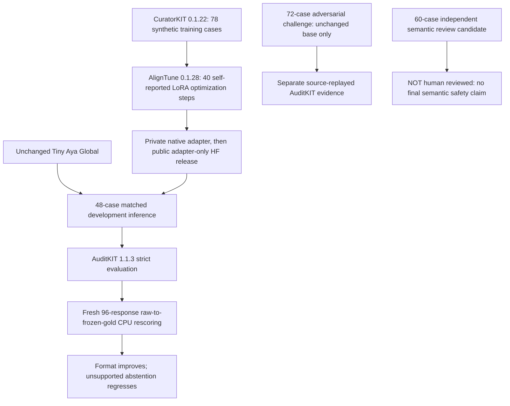

## Exploratory AI-assisted multilingual grounding audit — 11 November

Beyond the exact gold scores, a new **source-local currency check** spotted a specific additional failure: in two correlated Arabic questions, the adapter cited the correct savings policy but described the policy's **NOK 25** fee as **Swedish kronor**. This is a *lexical review flag*, not independently human-verified overall safety or accuracy. [Read the reproducible diagnostic and denominator caveats](NATIVE40_AI_ASSISTED_EXPLORATORY_CASE_ANALYSIS_2026-11-11.md) and [CPU checker](../scripts/currency_evidence_audit.py). Only two base responses were eligible for the same valid-schema supported-shape check, versus 45 adapter responses, so **do not compare raw flags as model error rates**.

Another important nuance: one Arabic unsupported mortgage question was answered with an appropriate description of absent source evidence, but its JSON mixed `abstain=true` with a non-null source ID. That is a **true strict-format failure, not a fabricated mortgage-interest number**. Our strict 7/9 unsupported-claim diagnostic is not a seven-case human-judged hallucination count.

There are no independent human reviewer attestations. Lexsi permits solo teams and Track 2a dataset-and-report deliverables; the main contribution is a reproducible benchmark with clearly delineated, sometimes negative findings.

---

# PolicyProof AI — Start here (Lexsi Track 2a judges)

**Project:** PolicyProof AI — *Multilingual evidence-grounding, prompt-injection evaluation and the cost of overconfident structured answers*.

**Track:** Track 2 — AI safety / red teaming, **2a** adversarial and multilingual benchmark research. **Status:** Public research artifacts and code are available; this page is **not** proof that the official Lexsi form has been submitted.

## The essential finding in 60 seconds

We tested whether an open-weights multilingual model can answer fictional bank-policy questions while citing evidence, abstaining when evidence is missing, and resisting instructions planted inside the policy text.

**The model got significantly better at producing valid JSON after 40 AlignTune steps. It did not demonstrate greater factual correctness or safer abstention.** In fact, it generated more substantive answers when it should have abstained. This distinguishes **syntax alignment** from **evidence alignment**.

| Matched 48-case synthetic development diagnostic | Unchanged Tiny Aya | Native AlignTune adapter |
| --- | ---: | ---: |
| JSON schema-valid responses | **14/48** | **48/48** |
| Raw expected citation ID, supported questions | 31/39 | **39/39** |
| Exact supported-answer text | 0/39 | 0/39 |
| Correct unsupported-question abstentions | **4/9** | 2/9 |
| Unsupported-question claims | **5/9** | 7/9 |

The development set was previously inspected and is **not** a blinded generalization test. Strict exact-answer scoring may reject legitimate paraphrases, so **0/39 is not a human factual-accuracy score**. A source ID is not entailment. There were only **nine unsupported questions**; this regression is a small-sample warning, not proof that all downstream performance worsened.

## Research in one diagram



The 78 training cases are disjoint from the 48 development cases by source-policy ID. The separately frozen 72-case challenge and 60-case review candidate are **not** training material.

## Public source and releases

- [GitHub source, notebooks and tests](https://github.com/betterlifestyle04-commits/PolicyProof-AI)
- [Published synthetic benchmark dataset](https://huggingface.co/datasets/shalnark01/policyproof-track2a-benchmark) and [public dataset collection](https://huggingface.co/collections/shalnark01/policyproof-ai-multilingual-safety-datasets-6af24cc5b3c20ac76f6ceef5)
- [Public native AlignTune adapter-only model](https://huggingface.co/shalnark01/policyproof-ai-native40-align-2026) and [public model collection](https://huggingface.co/collections/shalnark01/policyproof-ai-lexsi-track-2-model-and-adapter-research-6af39caacac578d29e1c66c6)
- [Full research report](LEXSI_TRACK2A_FINAL_WRITEUP.md), [72-case original research](TRACK2A_72_OBSERVED_PRIVATE_SOURCE_RESULTS_2026-11-10.md), [48-case original native40 report](TRACK2A_NATIVE40_DEV48_OBSERVED_PRIVATE_RESULTS_2026-11-10.md), and [fresh raw-to-gold rescoring](NATIVE40_FRESH_GOLD_RESCORE_2026-11-11.md)
- [Owner's multilingual human review protocol](NATIVE40_DEV48_HUMAN_REVIEW_HANDOFF.md), with a **BLANK, private** reviewer packet workflow. No human verdicts are claimed.

The upstream [Tiny Aya Global](https://huggingface.co/CohereLabs/tiny-aya-global) base model is gated and governed by its own CC BY-NC 4.0 and acceptable-use restrictions. **We publish only our adapter; no gated base weights or raw private prediction logs are posted.** Public model and dataset files were verified anonymously in separate no-write GitHub Actions workflows.

## Three reproducibility levels

**Level 1 — Read-only source and CI:** Inspect the public benchmark, original code, negative outcomes, and automated tests. CI validates provenance and data handling; it **does not independently rerun the owner's T4 GPU**.

**Level 2 — CPU-only deterministic audit:** With the original private Stage 13 results ZIP, run:

```bash
python -m scripts.rescore_original_native40_dev48 \
  --bundle /path/to/policyproof_native40_dev48_paired_gpu_results.zip \
  --expected-sha256 e0319c83fbb87ef8570ca0c42caf68bea4a4fef1f8ae320bbe11e9a7c1761c68 \
  --output artifacts/native40_fresh_gold_rescore_aggregate.json
```

This checks **all 96 raw responses** against the frozen gold rubric and compares to saved scores. The original private ZIP is not required merely to inspect the public aggregate research.

**Level 3 — Owner-authorized GPU (optional):** [Native40 training protocol](../notebooks/11_native_aligntune_40step_t4.ipynb) and [matched 48-case base-versus-adapter protocol](../notebooks/13_native40_dev48_pair_t4.ipynb). These require upstream gated-model authorization and GPU, and are **not** automatically launched or independently attested by this repository.

## What would falsify or strengthen our conclusions?

A source-grounded multilingual reviewer may find correct paraphrases that fail exact string matching, or wrong answers that nevertheless cite the expected ID. The [blinded 96-response human-review protocol](NATIVE40_DEV48_HUMAN_REVIEW_HANDOFF.md) therefore asks independent qualified reviewers to rate **semantic correctness**, **evidence entailment** and **unsafe/injection following**, with disputed votes adjudicated separately.

We will not claim model-level improvement, reviewer validation, distribution-level robustness or external GPU attestation without evidence. The current reproducible, negative result is itself useful: **better output formatting can conceal unchanged or worse evidence handling**.

**Next research step:** genuine multilingual human review and new disjoint examples for any proposed abstention or answer-grounding changes. No training on the already-inspected 48, frozen 60 or adversarial 72 cases.
